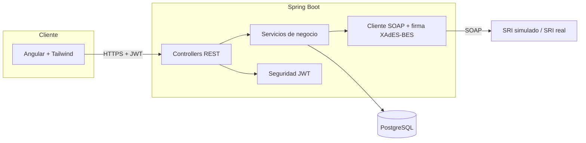
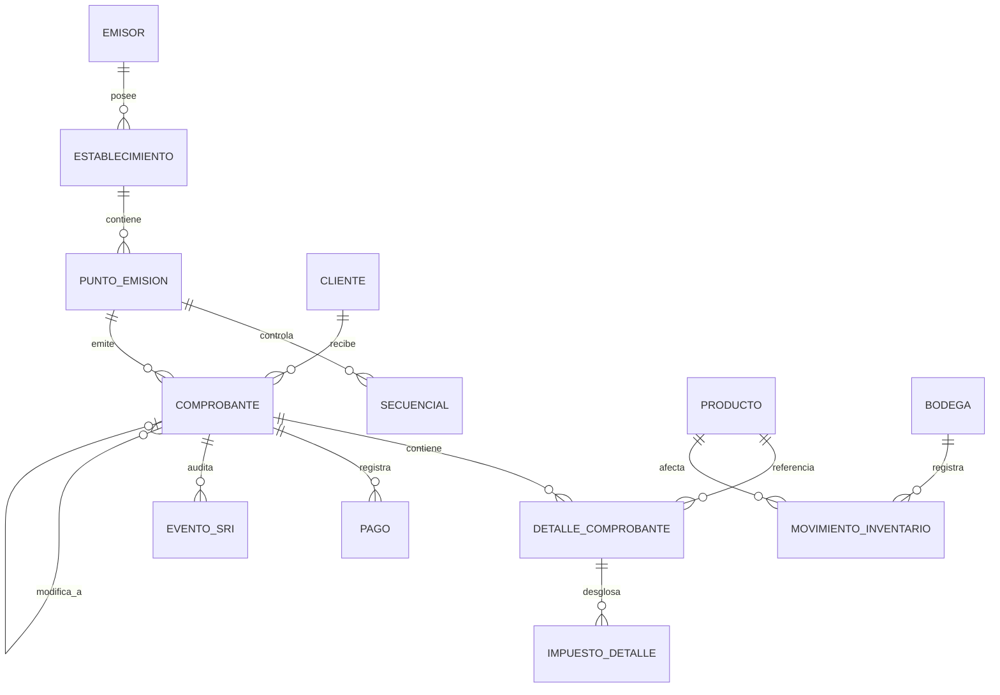

# Facturador SRI — POS, inventario y facturación electrónica para Ecuador

Sistema de punto de venta con inventario que emite facturas y notas de
crédito electrónicas válidas según el esquema **offline** del SRI
(Servicio de Rentas Internas de Ecuador): genera el XML, lo firma con
XAdES-BES, lo envía a los web services de Recepción/Autorización, y
produce el RIDE en PDF con el código de barras de la clave de acceso.

[](https://github.com/DiegoFranciscoG/facturador-sri/actions/workflows/ci.yml)


## Demo en vivo y usuario de prueba

Aún no está desplegado públicamente (ver [sección de despliegue](#despliegue)).
En local, el backend crea un único usuario administrador la primera vez
que arranca, con las credenciales que definas en tu `.env`
(`ADMIN_USERNAME` / `ADMIN_PASSWORD`) — no hay usuario ni contraseña
por defecto, por seguridad (ver [`docs/investigacion.md`](docs/investigacion.md)
y `SECURITY.md`).

## El problema que resuelve

Un negocio pequeño en Ecuador necesita, al mismo tiempo: (1) un punto de
venta simple para cobrar, (2) control de inventario (kardex) para no
vender lo que no tiene, y (3) comprobantes electrónicos **legalmente
válidos** ante el SRI, con la clave de acceso, la firma digital y el
XML exactos que exige la Ficha Técnica de Comprobantes Electrónicos.
Este proyecto integra las tres cosas en un solo flujo: vender un
producto genera automáticamente la factura electrónica, descuenta el
inventario, y deja rastro de cada intento de comunicación con el SRI.

## Funcionalidades

- **Punto de venta (POS)**: seleccionar cliente, bodega y productos;
  cálculo de IVA en vivo; emisión de factura con un clic.
- **Inventario**: kardex por producto y bodega (entradas, salidas,
  ajustes, devoluciones), con saldo corriente y bloqueo de ventas si no
  hay stock suficiente.
- **Clientes y productos**: alta con validación de cédula/RUC (módulo
  10/11 real) y de los catálogos oficiales del SRI.
- **Facturación electrónica real**: clave de acceso de 49 dígitos
  (módulo 11), XML según la estructura de la Ficha Técnica, firma
  XAdES-BES, envío a Recepción/Autorización del SRI (o a un SRI
  simulado con WireMock, por defecto), y máquina de estados completa
  (`GENERADO → FIRMADO → RECIBIDO → AUTORIZADO/NO_AUTORIZADO/DEVUELTA`)
  con cola de reintentos automática.
- **Notas de crédito**: siempre referencian la factura original,
  exigen un motivo, y restituyen el inventario.
- **RIDE en PDF**: representación impresa con código de barras
  (GS1-128) de la clave de acceso.
- **Seguridad**: login con JWT, contraseñas con BCrypt, límite de
  intentos de inicio de sesión, CORS explícito, y todos los secretos
  por variable de entorno.

## Cómo se usa (flujo típico)

1. Entra con el usuario administrador que configuraste en `.env`.
2. Crea productos (con su tarifa de IVA) y clientes desde el menú
   lateral, o usa los datos de ejemplo que trae el sistema.
3. Ve a **Punto de venta**: elige cliente y bodega, agrega productos
   con su cantidad, elige la forma de pago y pulsa **Emitir factura**.
   El sistema calcula el IVA, genera la clave de acceso, firma el XML
   y lo envía al SRI (simulado o real, según `SRI_MODO`); verás el
   estado resultante al instante.
4. En **Comprobantes** puedes ver el historial, filtrar por estado,
   descargar el XML firmado/autorizado y el RIDE en PDF, y emitir una
   nota de crédito sobre cualquier factura ya **AUTORIZADA**.
5. Si el SRI responde "en procesamiento" o hay un error de red, el
   comprobante queda pendiente y un proceso interno (cada minuto)
   reintenta automáticamente sin que tengas que hacer nada.

## Arquitectura



Capas del backend: `controller` (HTTP) → `service` (reglas de negocio,
incluida la máquina de estados del comprobante) → `repository` (Spring
Data JPA) → `domain` (entidades). Los `dto` son el contrato de entrada
y salida de la API; los `mapper` (MapStruct) convierten entre DTO y
entidad; `exception` centraliza los errores sin exponer detalles
internos.

## Stack y por qué

| Capa | Tecnología | Por qué |
|---|---|---|
| Backend | Java 17, Spring Boot 4.1 | Ecosistema maduro para JPA, seguridad y SOAP; tipado fuerte para las reglas fiscales |
| Base de datos | PostgreSQL 16 (Flyway) | Migraciones versionadas y auditables, gratis en Neon para producción |
| Firma XML | `javax.xml.crypto` (JSR-105, incluido en el JDK) | Evita depender de una librería externa de firma; verificado con un test que valida la firma contra el estándar XML-DSig |
| SOAP al SRI | Cliente propio sobre `RestClient` | El WSDL real no se pudo descargar para generar el cliente (ver `docs/investigacion.md`); un cliente manual es más simple de mantener y de simular con WireMock |
| Simulación del SRI | WireMock | Permite probar todo el flujo (incluyendo rechazos y "en procesamiento") sin RUC ni firma real |
| Frontend | Angular 22 (standalone) + Tailwind v4 | Componentes aislados, sin NgModules; Tailwind para una interfaz consistente sin escribir CSS a mano |
| Contenedores | Docker multi-stage | Imágenes pequeñas, sin herramientas de build en producción |

## Modelo de datos

Ver el detalle completo, con las reglas de negocio y su fuente, en
[`docs/modelo-datos.md`](docs/modelo-datos.md). Resumen:



## Cómo ejecutar en local

### Con Docker (recomendado)

```bash
cp .env.example .env
# Edita .env: define DB_PASSWORD, JWT_SECRET, ADMIN_USERNAME y ADMIN_PASSWORD
docker compose up --build
```

Esto levanta Postgres, un SRI simulado (WireMock) con los stubs de
recepción/autorización, el backend en `http://localhost:8080` y el
frontend en `http://localhost:4200`.

### Sin Docker

Backend (requiere Postgres accesible con las variables de `.env.example`
exportadas como variables de entorno):

```bash
./mvnw spring-boot:run
```

Frontend:

```bash
cd frontend
npm install
npm start
```

## Variables de entorno

Ver [`.env.example`](.env.example) para la lista completa. Ninguna
tiene un valor por defecto real: si falta una variable crítica
(`DB_PASSWORD`, `JWT_SECRET`, `ADMIN_USERNAME`, `ADMIN_PASSWORD`), la
aplicación no arranca.

| Variable | Para qué |
|---|---|
| `DB_URL`, `DB_USER`, `DB_PASSWORD` | Conexión a PostgreSQL |
| `JWT_SECRET` | Firma de los tokens (mínimo 256 bits) |
| `ADMIN_USERNAME`, `ADMIN_PASSWORD` | Usuario administrador que se crea al primer arranque |
| `CORS_ALLOWED_ORIGINS` | Orígenes permitidos para el frontend |
| `SRI_MODO` | `SIMULADO` (WireMock, por defecto) o `PRUEBAS-SRI` (ambiente real de pruebas del SRI) |
| `SRI_CERTIFICADO_P12_PATH`, `SRI_CERTIFICADO_P12_PASSWORD` | Solo si `SRI_MODO=PRUEBAS-SRI`: tu certificado de firma electrónica real |

## API

Documentación interactiva en `http://localhost:8080/swagger-ui.html`
una vez levantado el backend. Endpoints principales:

| Método | Ruta | Qué hace |
|---|---|---|
| POST | `/api/auth/login` | Inicio de sesión (JWT) |
| GET/POST | `/api/clientes` | Listar / crear clientes |
| GET/POST | `/api/productos` | Listar / crear productos |
| POST | `/api/comprobantes/facturas` | Registrar una venta y emitir la factura |
| POST | `/api/comprobantes/notas-credito` | Emitir una nota de crédito |
| GET | `/api/comprobantes/{id}/xml` | XML firmado/autorizado |
| GET | `/api/comprobantes/{id}/ride` | RIDE en PDF |
| GET | `/api/inventario/kardex` | Movimientos de inventario de un producto/bodega |

## Tests y cobertura

- Backend: 94 tests (JUnit 5 + Mockito + Testcontainers + WireMock),
  incluyendo una prueba de extremo a extremo (venta → firmado →
  recibido → autorizado) contra un PostgreSQL real. `./mvnw test`.
- Frontend: Vitest (`npm test`), cobertura de la capa de autenticación.
- La firma XAdES-BES se verifica con un test que la valida contra el
  estándar XML-DSig, independiente del SRI.

## Despliegue

Pensado para el nivel gratuito de Render (backend) + Neon (Postgres) +
Vercel (frontend). Configuración lista en [`render.yaml`](render.yaml)
y [`frontend/vercel.json`](frontend/vercel.json); no se pudo verificar
contra cuentas reales en el desarrollo de este proyecto (ver
`docs/investigacion.md` sección 11).

## Seguridad aplicada

Deny-by-default en Spring Security, JWT con secreto de al menos 256
bits desde variable de entorno, BCrypt para contraseñas, rate limiting
en el login, CORS con orígenes explícitos, cabeceras de seguridad
(HSTS, X-Frame-Options, etc.), manejador global de errores sin stack
traces, Actuator solo expone `/health`, y ningún certificado ni
contraseña se versiona (el certificado de pruebas se genera en memoria
al arrancar). Detalle completo en [`SECURITY.md`](SECURITY.md).

## Decisiones técnicas

Ver [`docs/investigacion.md`](docs/investigacion.md) y
[`docs/modelo-datos.md`](docs/modelo-datos.md) para el detalle de cada
decisión con su fuente y las verificaciones pendientes (el WAF de
sri.gob.ec impidió descargar el XSD/WSDL oficiales durante el
desarrollo; el XML se reconstruyó de buena fe a partir de ejemplos
reales y queda documentado como pendiente de contrastar).

## Roadmap

- Validar el XML contra el XSD oficial del SRI en cuanto esté disponible.
- Asiento contable automático a partir de un comprobante autorizado.
- Edición de clientes y productos desde el frontend (hoy solo alta y baja).
- Reportes de ventas por rango de fechas.

## Fuentes de datos y licencias

Catálogos, algoritmo de la clave de acceso y tarifas de IVA: Servicio
de Rentas Internas del Ecuador (sri.gob.ec), ver el detalle de cada
fuente en [`docs/investigacion.md`](docs/investigacion.md). Todos los
datos de clientes/productos de ejemplo son ficticios.

## Autor

Diego Francisco Granda Zhingre — [GitHub](https://github.com/DiegoFranciscoG) · [LinkedIn](https://www.linkedin.com/in/diego-francisco-g-61b793254/) · [Portafolio](https://diegofranciscog.github.io/)
