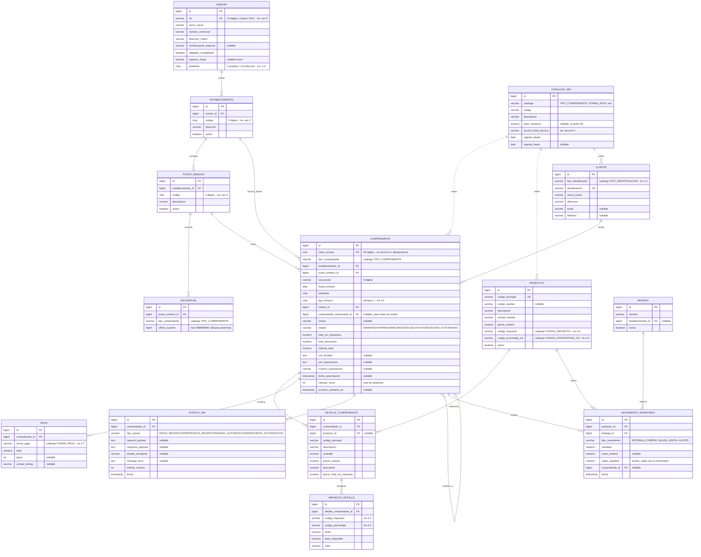

# Modelo de datos — Facturador SRI

Derivado de [`docs/investigacion.md`](./investigacion.md). Cada regla de
negocio referencia la sección de la investigación de la que sale.

## 1. Diagrama entidad-relación

## 2. Reglas de negocio y su fuente

| Regla | Fuente |
|---|---|
| La clave de acceso tiene 49 dígitos con la estructura de 10 campos descrita | `investigacion.md` §3 |
| El dígito verificador se calcula con módulo 11, coeficientes cíclicos 7→2 | `investigacion.md` §3 |
| `clave_acceso` es la clave natural de idempotencia: un mismo comprobante nunca se procesa dos veces | Requisito de aceptación del proyecto + `investigacion.md` §7 (RECIBIDA/DEVUELTA son respuestas del SRI a un envío, deben poder reintentarse sin duplicar) |
| El secuencial por punto de emisión y tipo de comprobante es correlativo, sin huecos, y se asigna con bloqueo pesimista (`SELECT ... FOR UPDATE` sobre la fila de `SECUENCIAL`) dentro de la misma transacción que crea el `COMPROBANTE` | Requisito explícito del enunciado ("bloqueo pesimista para no duplicar") |
| `tipo_emision` siempre vale `1` (normal) en el esquema offline | `investigacion.md` §4.4 |
| Los catálogos (`CATALOGO_SRI`) están versionados por `version_ficha_tecnica` para poder auditar contra qué versión de la Ficha Técnica se validó un comprobante histórico | Requisito explícito del enunciado + `investigacion.md` §1 (la Ficha Técnica cambia de versión con frecuencia: 2.26 → 2.34 solo en los últimos años) |
| Estados válidos de un comprobante: `GENERADO → FIRMADO → RECIBIDO → (DEVUELTA | AUTORIZADO | NO_AUTORIZADO)`, con reintento posible desde `DEVUELTA` | `investigacion.md` §2 y §7 |
| Una nota de crédito siempre referencia un comprobante existente (`comprobante_relacionado_id`) y requiere `motivo` | Reglamento de Comprobantes de Venta (mencionado en `investigacion.md` fuente #búsqueda tabla 24) — validar motivo obligatorio en el XSD real al descargarlo |
| El movimiento de inventario por una venta se crea en la misma transacción que el comprobante y calcula `saldo_cantidad` (kardex) | Requisito del enunciado ("bodegas, movimientos_inventario (kardex)") |
| `codigo_porcentaje_iva` de un producto determina la tarifa aplicada en `IMPUESTO_DETALLE`; el valor `4` = 15% es la tarifa general vigente en 2026 | `investigacion.md` §4.6 (marcado como SUPUESTO a confirmar contra el PDF oficial) |
| El RUC/cédula del emisor y del cliente se valida con los algoritmos de módulo 10 (cédula, persona natural) o módulo 11 (sociedad pública/privada) antes de guardar | `investigacion.md` §5 |
| Ningún certificado ni contraseña se almacena en base de datos; el `.p12` de pruebas se genera en tiempo de ejecución y vive fuera del repo/BD | Reglas maestras §3 + enunciado del proyecto |

## 3. Por qué `CATALOGO_SRI` es una sola tabla genérica

En vez de ocho tablas casi idénticas (`tipo_comprobante`, `tipo_identificacion`,
`codigo_impuesto`, `codigo_porcentaje_iva`, `forma_pago`, `ambiente`,
`tipo_emision`), se usa una tabla `catalogo_sri(catalogo, codigo, descripcion,
valor_numerico, version_ficha_tecnica, vigente_desde, vigente_hasta)` con un
`UNIQUE(catalogo, codigo, version_ficha_tecnica)`. Esto evita duplicar el
mismo patrón ocho veces y permite versionar todos los catálogos igual cuando
el SRI publique una nueva Ficha Técnica, sin migraciones nuevas por cada
tabla — solo un `INSERT` con la nueva versión y fechas de vigencia.

## 4. Migraciones Flyway

Ver `src/main/resources/db/migration/`. Convención: `V<n>__descripcion.sql`.
Todas las migraciones de esquema van primero; los seeds ficticios van en
migraciones separadas (`V6`, `V7`) para poder excluirlas fácilmente en un
perfil de producción real si algún día este proyecto deja de ser una demo.

| Migración | Contenido |
|---|---|
| `V1__crear_configuracion.sql` | `emisor`, `establecimiento`, `punto_emision`, `secuencial` |
| `V2__crear_catalogos_sri.sql` | `catalogo_sri` |
| `V3__crear_terceros_productos.sql` | `cliente`, `producto` |
| `V4__crear_inventario.sql` | `bodega`, `movimiento_inventario` |
| `V5__crear_comprobantes.sql` | `comprobante`, `detalle_comprobante`, `impuesto_detalle`, `pago`, `evento_sri` |
| `V6__seed_catalogos_sri.sql` | Catálogos oficiales versión 2.34 (datos públicos, no personales) |
| `V7__seed_datos_demo.sql` | Emisor, establecimiento, punto de emisión, secuenciales, cliente y producto **ficticios** para desarrollo local |

## 5. Pendiente de ajustar tras verificación del XSD oficial

Cuando abras el ZIP de XSD (enlaces en `investigacion.md` §1), si algún
`minOccurs`/`maxOccurs` u orden de campos difiere de lo modelado aquí
(especialmente en `infoFactura` y los bloques opcionales de comercio
exterior), lo ajusto antes de escribir las clases JAXB en D2 — el modelo
relacional no cambia, solo el mapeo XML.
